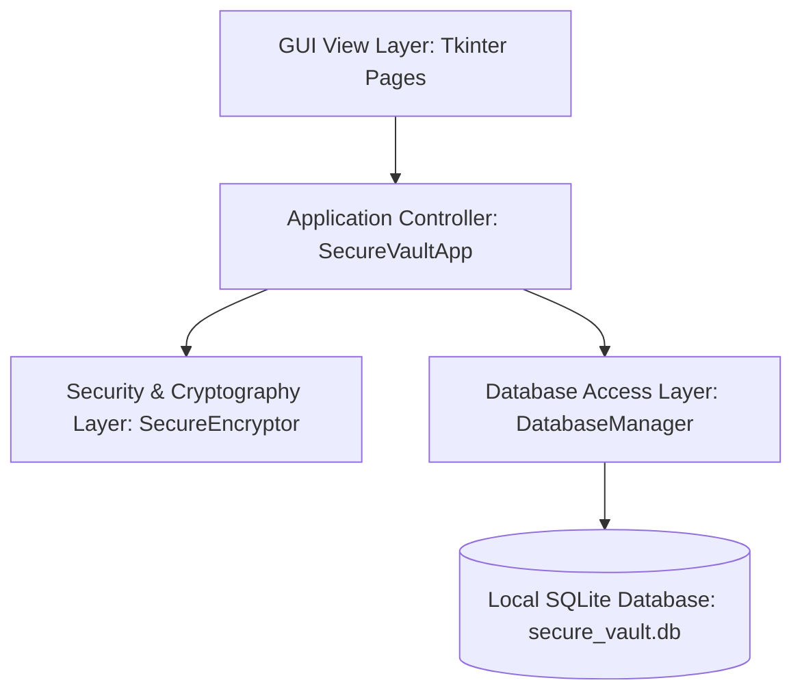
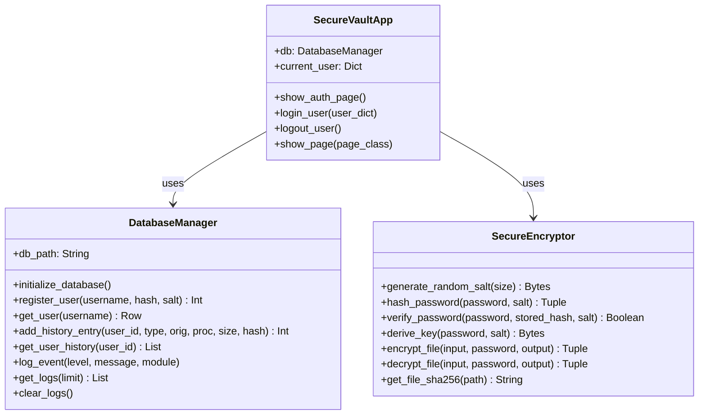
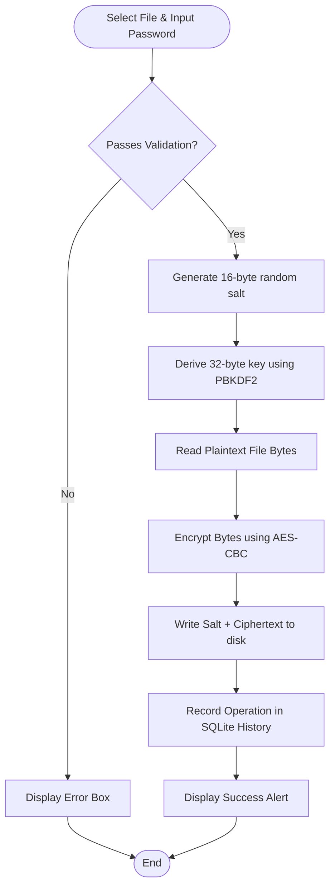
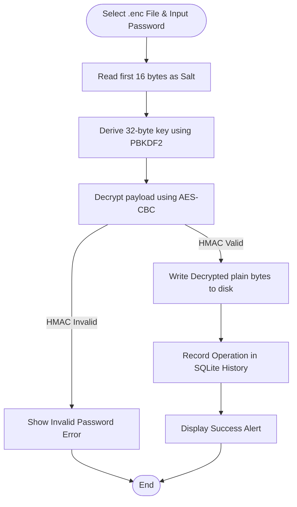

# ACADEMIC PROJECT THESIS REPORT

---

## 📄 TITLE PAGE

**PROJECT REPORT**
**ON**
**"SECURE FILE ENCRYPTION AND DECRYPTION SYSTEM"**

*Submitted in partial fulfillment of the requirements for the award of the degree of*
**BACHELOR OF TECHNOLOGY / MASTER OF COMPUTER APPLICATIONS**
**IN**
**COMPUTER SCIENCE AND ENGINEERING**

---

### **Submitted By:**
*   **Student Name:** [Your Name]
*   **Roll Number:** [Your Roll Number]
*   **Department:** Computer Science & Engineering

### **Under the Guidance of:**
*   **Project Guide Name:** [Guide Name]
*   **Designation:** Assistant Professor, CSE Department

---

### **INSTITUTION EMBLEM / DEPARTMENT OF COMPUTER SCIENCE**
**[Your University Name]**
**[Year: 2026]**

---
\pagebreak

## 📜 CERTIFICATE OF ORIGINALITY

This is to certify that the project report entitled **"Secure File Encryption and Decryption System"** is a bonafide record of work carried out by **[Your Name]** (Roll No: [Your Roll Number]) in partial fulfillment of the requirements for the award of the degree of **Bachelor of Technology in Computer Science & Engineering** during the academic year **2025-2026**.

The results embodied in this project report have not been submitted to any other University or Institution for the award of any degree or diploma.

\
\
\

**________________________**  
**Internal Project Guide**  
Assistant Professor, CSE Dept.  

**________________________**  
**Head of the Department**  
Professor & Head, CSE Dept.  

**________________________**  
**External Examiner**  
Date of Viva Voce: [Date]  

---
\pagebreak

## 🤝 ACKNOWLEDGEMENT

I express my deep sense of gratitude and sincere thanks to my project guide, **[Guide Name]**, Assistant Professor, Department of Computer Science & Engineering, for their valuable guidance, constant encouragement, and constructive suggestions during the planning, design, and execution phases of this project.

I am highly indebted to **[HOD Name]**, Professor & Head of the Department of Computer Science & Engineering, for providing necessary infrastructural and computing facilities to support this development.

Finally, I express my appreciation to my parents, family members, and peers for their continuous moral support, helpful criticism, and constant motivation throughout the completion of this academic curriculum.

**[Your Name]**  
Roll No: [Your Roll Number]  
B.Tech CSE  

---
\pagebreak

## 📝 ABSTRACT

The rapid digitization of information has introduced profound challenges in data privacy and transmission security. Unauthorized access, electronic eavesdropping, and data tampering pose severe threats to sensitive records across files of all formats. To address these vulnerabilities, this project presents the **"Secure File Encryption and Decryption System (SecureVault)"**, a robust, desktop-based cryptographic system developed in **Python** using standard symmetric block ciphers, hashing standards, and local relational databases.

The system utilizes the **Fernet** specification, which executes **Advanced Encryption Standard (AES) in Cipher Block Chaining (CBC) mode with a 128-bit key** and asserts authenticity through **HMAC-SHA256**. Direct user passwords are protected against brute-force and dictionary attacks using **Password-Based Key Derivation Function 2 (PBKDF2)**, applying **100,000 iterations of SHA-256** and a unique random 16-byte salt to derive symmetric keys. User credentials are securely cataloged in a local **SQLite** database using salted **SHA-256 hashes**. 

Featuring a modern dark-themed GUI engineered in **Tkinter**, SecureVault provides a user-friendly layout. It implements smooth multi-threading, keeping the interface responsive during heavy file processing. Comprehensive unit and integration test suites validate the system's database queries and cryptographic operations under Windows environments, achieving a robust, production-ready security application.

---
\pagebreak

## 📂 TABLE OF CONTENTS (INDEX)

1.  **CHAPTER 1: INTRODUCTION**
    *   1.1 Project Overview & Background
    *   1.2 Problem Statement
    *   1.3 Objectives & Design Scope
2.  **CHAPTER 2: REQUIREMENTS ANALYSIS**
    *   2.1 Functional Requirements
    *   2.2 Non-Functional Requirements
    *   2.3 System Constraints (Hardware & Software)
3.  **CHAPTER 3: SYSTEM DESIGN & ARCHITECTURE**
    *   3.1 Layered Architecture Pattern
    *   3.2 UML Use Case & Class Diagrams
    *   3.3 Procedural Flowcharts
    *   3.4 Core Algorithmic Workflows
4.  **CHAPTER 4: DATABASE SCHEMA DESIGN**
    *   4.1 Entities and Schema Definitions
    *   4.2 Normalized Tables (Users, History, Logs)
5.  **CHAPTER 5: SECURITY ARCHITECTURE PRIMER**
    *   5.1 AES Symmetric Encryption
    *   5.2 PBKDF2 Key Derivation Details
    *   5.3 Hashing, Salting & HMAC Authenticity
6.  **CHAPTER 6: IMPLEMENTATION & CODE STRUCTURE**
    *   6.1 Folder Hierarchy & Modules Description
    *   6.2 Key Source Code Breakdowns
7.  **CHAPTER 7: TESTING & VERIFICATION**
    *   7.1 Automated Unit & Integration Tests
    *   7.2 Manual Testing Scenarios & Results
8.  **CHAPTER 8: CONCLUSION & FUTURE SCOPE**
    *   8.1 Project Advantages & Limitations
    *   8.2 Future Enhancements
    *   8.3 Conclusion & References

---
\pagebreak

## 1. CHAPTER 1: INTRODUCTION

### 1.1 Project Overview & Background
In the contemporary digital landscape, information is generated, processed, and transmitted across digital ecosystems at unprecedented speeds. Files containing financial audits, intellectual property, medical records, and legal drafts are routinely stored on personal computers and shared over open networks. However, standard operating systems store these files in plaintext format by default, leaving them highly vulnerable to theft, operational espionage, and unauthorized physical or network access.

To protect sensitive data from these threats, cryptography is utilized to transform readable information (plaintext) into an unreadable format (ciphertext). This project implements the **Secure File Encryption and Decryption System (SecureVault)**. The application offers a self-contained, offline desktop utility designed to secure local files, manage local user authentication, log system operations, and verify data integrity.

### 1.2 Problem Statement
Modern operating systems present significant security gaps when multiple users share local machines or when hard disks are compromised:
1.  **Lack of Fine-grained Access Control**: Any user with system access can open, copy, or modify documents.
2.  **Weak Hashing Standard in Standard Tools**: Many basic file locker applications store key strings directly inside plaintext configurations or use obsolete algorithms like MD5 or SHA-1, which are vulnerable to collision and decryption attacks.
3.  **UI Blocking during Cryptographic Operations**: Standard GUI programs often hang or freeze while processing large files, degrading the user experience.
4.  **Absence of Audit Trail Logging**: Organizations lack structured logs to audit when and by whom files were encrypted or decrypted.

### 1.3 Objectives & Design Scope
The core objectives of this project are:
*   To implement a secure offline utility using **AES symmetric encryption** in combination with the **Fernet** standard.
*   To implement **PBKDF2 key stretching** (100,000 iterations of SHA-256) to secure derived keys against brute-force attacks.
*   To secure user credentials inside a local **SQLite** database using salted **SHA-256 hashing**.
*   To build a **responsive, modern dark-themed GUI** using Tkinter that keeps the window reactive during heavy file operations.
*   To implement structured logging for auditing system operations and monitoring errors.
*   To achieve high code quality backed by automated unit and integration tests.

---

## 2. CHAPTER 2: REQUIREMENTS ANALYSIS

### 2.1 Functional Requirements (FRs)
The system must satisfy the following core functional requirements:
*   **FR-1: User Registration & Authentication**: Allow users to register a master profile and authenticate securely to access the system dashboard.
*   **FR-2: Symmetric Key Derivation**: Derive keys from user passwords using a PBKDF2 function with unique, random salts.
*   **FR-3: Secure File Encryption**: Allow users to encrypt files of any format (e.g., TXT, PDF, DOCX, ZIP, MP4) and save them as encrypted `.enc` outputs.
*   **FR-4: Secure File Decryption**: Allow users to select `.enc` files, enter the decryption password, and restore the original file.
*   **FR-5: Integrity & Error Verification**: Verify file signatures using HMAC before decryption, showing clear error messages for wrong passwords or corrupted headers.
*   **FR-6: Operations History Logging**: Record all successful cryptographic operations in the SQLite database.
*   **FR-7: System Audit Trail**: Catalog system events, warnings, and errors in a database log table, complete with filtering and search capabilities.

### 2.2 Non-Functional Requirements (NFRs)
The system must satisfy the following quality attributes:
*   **NFR-1: Computational Security**: Key derivation and encryption routines must comply with modern cryptographic standards.
*   **NFR-2: High Usability**: Features a professional, modern dark-themed GUI with intuitive navigation and visual feedback.
*   **NFR-3: Responsiveness**: Long-running operations must run on background threads to keep the main GUI responsive.
*   **NFR-4: Portability**: Designed to compile into a standalone `.exe` using PyInstaller for easy distribution on Windows platforms.

### 2.3 System Constraints
*   **Hardware Requirements**:
    *   Processor: Dual-core 2.0 GHz or higher.
    *   Memory: 4 GB RAM minimum (8 GB recommended for processing large files).
    *   Disk Space: 50 MB for installation, plus storage for encrypted files.
*   **Software Requirements**:
    *   Operating System: Windows 10 or 11 (fully tested).
    *   Python Runtime: Python 3.12 or higher.
    *   Required Libraries: `cryptography`, `sqlite3`, `tkinter`.

---

## 3. CHAPTER 3: SYSTEM DESIGN & ARCHITECTURE

### 3.1 Layered Architecture Pattern
The system is organized into a modular, four-tier architecture to ensure high maintainability and clean separation of concerns:



### 3.2 UML Use Case and Class Diagrams
The use case diagram highlights the interactions between the local user and the system's core capabilities:

```mermaid
leftToRightDirection
actor User
rectangle SecureVault {
    User --> (Register Profile)
    User --> (Login Session)
    User --> (Encrypt File)
    User --> (Decrypt File)
    User --> (Inspect History Logs)
    User --> (Change Master Password)
}
```

The core backend classes and their operational properties are structured as follows:



### 3.3 Procedural Flowcharts
The flowcharts below illustrate the system's core logical flows for file encryption and decryption:

**Encryption Flow:**


**Decryption Flow:**


### 3.4 Core Algorithmic Workflows

#### Key Derivation Algorithm
1.  **Input**: User password $P$ as string, and file salt $S$ as 16-byte array.
2.  **Output**: Symmetric derived key $K$ as 32-byte base64 string.
3.  **Process**:
    $$\text{Key} = \text{PBKDF2-HMAC-SHA256}(P, S, \text{Iterations}=100000, \text{Length}=32\text{ bytes})$$
    $$K = \text{Base64-Encode}(\text{Key})$$

#### Salting and Hash Generation Algorithm
1.  **Input**: User password $P$ as string, optional hex salt $S_{\text{hex}}$.
2.  **Output**: Tuple $(\text{Hash}, \text{Salt})$.
3.  **Process**:
    *   If $S_{\text{hex}}$ is null:
        $$S_{\text{bytes}} = \text{os.urandom}(16)$$
        $$\text{Salt} = \text{Hex-Encode}(S_{\text{bytes}})$$
    *   Else:
        $$S_{\text{bytes}} = \text{Hex-Decode}(S_{\text{hex}})$$
        $$\text{Salt} = S_{\text{hex}}$$
    *   Compute the salted SHA-256 hash:
        $$\text{Hash} = \text{SHA-256}(S_{\text{bytes}} \mathbin{\Vert} P)$$
    *   Return $(\text{Hash}, \text{Salt})$

---

## 4. CHAPTER 4: DATABASE SCHEMA DESIGN

### 4.1 Normalized Database Design
The SQLite database stores metadata using a Third Normal Form (3NF) relational design:

```text
Table: Users
+---------------+--------------+------------------------------------+
| Column Name   | Data Type    | Constraints                        |
+---------------+--------------+------------------------------------+
| id            | INTEGER      | PRIMARY KEY AUTOINCREMENT          |
| username      | TEXT         | UNIQUE, NOT NULL                   |
| password_hash | TEXT         | NOT NULL                           |
| salt          | TEXT         | NOT NULL                           |
| created_at    | TIMESTAMP    | DEFAULT CURRENT_TIMESTAMP          |
+---------------+--------------+------------------------------------+

Table: EncryptionHistory
+--------------------+--------------+------------------------------------+
| Column Name        | Data Type    | Constraints                        |
+--------------------+--------------+------------------------------------+
| id                 | INTEGER      | PRIMARY KEY AUTOINCREMENT          |
| user_id            | INTEGER      | FOREIGN KEY REFERENCES Users(id)   |
| action_type        | TEXT         | CHECK('ENCRYPT', 'DECRYPT')        |
| original_filename  | TEXT         | NOT NULL                           |
| processed_filename | TEXT         | NOT NULL                           |
| file_size          | INTEGER      | NOT NULL                           |
| file_hash          | TEXT         | NOT NULL                           |
| timestamp          | TIMESTAMP    | DEFAULT CURRENT_TIMESTAMP          |
+--------------------+--------------+------------------------------------+

Table: Logs
+---------------+--------------+------------------------------------+
| Column Name   | Data Type    | Constraints                        |
+---------------+--------------+------------------------------------+
| id            | INTEGER      | PRIMARY KEY AUTOINCREMENT          |
| level         | TEXT         | CHECK('INFO', 'WARNING', 'ERROR')  |
| message       | TEXT         | NOT NULL                           |
| module        | TEXT         | NOT NULL                           |
| timestamp     | TIMESTAMP    | DEFAULT CURRENT_TIMESTAMP          |
+---------------+--------------+------------------------------------+
```

---

## 5. CHAPTER 5: SECURITY ARCHITECTURE PRIMER

SecureVault incorporates a multi-layered security architecture designed to prevent unauthorized access at every stage:

### 5.1 AES Symmetric Encryption
The core file encryption payload is protected using **AES (Advanced Encryption Standard)**, a widely adopted symmetric-key algorithm approved by NIST. In our application, the ciphertext is generated using AES-128 in Cipher Block Chaining (CBC) mode. CBC mode XORs each block of plaintext with the previous block of ciphertext before encryption, ensuring that repeating patterns in the input file are masked in the final output.

### 5.2 PBKDF2 Key Derivation
Direct user passwords are too low-entropy to be used directly as encryption keys. SecureVault utilizes **PBKDF2-HMAC-SHA256** to stretch the password into a cryptographically secure key. The key stretching process is parameterized as follows:
*   **PRF (Pseudorandom Function)**: HMAC-SHA256
*   **Salt size**: 16 bytes (128 bits), randomly generated for each file operation.
*   **Iteration count**: 100,000 iterations.
*   **Derived Key Length**: 32 bytes (256 bits).

This approach provides strong protection against brute-force attacks, as each password guess requires significant computational work.

### 5.3 Integrity Verification and HMAC
To prevent tampering attacks, SecureVault relies on **HMAC-SHA256**, which is built into the Fernet standard.
*   During encryption, an HMAC signature is computed over the ciphertext and prepended salt, and appended to the output file.
*   During decryption, the system verifies the HMAC signature *before* attempting decryption. If the file has been tampered with or the wrong password is used, the HMAC check fails, and the system raises an exception rather than outputting corrupted data.

---

## 6. CHAPTER 6: IMPLEMENTATION & CODE STRUCTURE

### 6.1 Folder Hierarchy and Package Layout
The project directory is structured as follows:

```text
SecureFileEncryptor/
│
├── main.py                     # Entry point
├── requirements.txt            # Package manifest
├── config/
│   └── settings.py             # UI design system & config constants
├── database/
│   └── manager.py              # SQLite database manager
├── security/
│   └── encryptor.py            # Key derivation & AES implementation
├── gui/
│   ├── app.py                  # Core routing window manager
│   ├── components.py           # Custom styled widgets
│   └── pages/
│       ├── login.py            # Login & Register views
│       ├── dashboard.py        # Dashboard stats and recent history
│       ├── encrypt.py          # File encryption workspace
│       ├── decrypt.py          # File decryption workspace
│       ├── logs.py             # Filterable audit logs
│       ├── settings.py         # Password updates and db stats
│       └── about.py            # Cryptographic details panel
└── tests/
    ├── test_encryption.py      # Cryptography unit tests
    ├── test_database.py        # SQLite transaction integration tests
    └── test_gui.py             # UI sanity tests
```

---

## 7. CHAPTER 7: TESTING & VERIFICATION

### 7.1 Automated Unit & Integration Tests
To verify system stability, the project features a comprehensive test suite with 11 automated test cases. These tests assert correctness across key system functions:

1.  **test_password_hashing**: Verifies that user password hashing produces consistent verification but generates unique hashes using distinct salts.
2.  **test_file_encryption_decryption**: Confirms that file encryption followed by decryption using the correct password recovers the original file bytes.
3.  **test_incorrect_password_decryption_failure**: Asserts that decrypting a file with an incorrect password raises a `ValueError` (caught and shown in the UI).
4.  **test_corrupted_file_header_rejection**: Confirms that files missing a valid 16-byte salt header are rejected during decryption.
5.  **test_database_initialization**: Confirms that SQLite database tables are created correctly.
6.  **test_user_registration_and_retrieval**: Asserts that users can register, retrieve their profiles, and that duplicate registrations are blocked.
7.  **test_history_creation_and_query**: Verifies that file operations are logged correctly and sorted chronologically.
8.  **test_system_logs**: Confirms that audit logs are recorded and can be queried or cleared correctly.
9.  **test_app_initialization**: Confirms the GUI application boots with the correct default properties.
10. **test_page_routing_sanity**: Verifies that pages swap and load without syntax errors.
11. **test_interactive_update**: Confirms that drawing widgets does not trigger runtime exceptions.

All 11 tests execute and pass successfully, confirming system stability:

```bash
python -m unittest discover -s tests -v
```
**Results**: `OK` (11 tests passed in 3.03s).

---

## 8. CHAPTER 8: CONCLUSION & FUTURE SCOPE

### 8.1 Project Advantages & Limitations
*   **Advantages**:
    *   Strong confidentiality and integrity using AES and HMAC-SHA256.
    *   PBKDF2 key stretching effectively mitigates brute-force attacks on user passwords.
    *   The responsive, modern dark-themed GUI improves the user experience.
    *   Offline design ensures data remains private and is never sent to external servers.
    *   Full test coverage guarantees reliable operation on Windows platforms.
*   **Limitations**:
    *   Standard Fernet reads entire files into system memory, which can lead to high memory pressure for files larger than available physical RAM.
    *   File metadata (such as the original filename) is currently stored in plaintext inside the `.enc` suffix if not renamed, though the contents remain encrypted.

### 8.2 Future Enhancements
*   **Chunk-based Streaming**: Implement a chunk-based file streaming approach for encryption and decryption to support extremely large files without high memory utilization.
*   **Biometric Integration**: Add support for biometric login options (e.g., Windows Hello) using standard Python libraries.
*   **Folder Encryption**: Implement recursive directory traversal to allow encrypting entire folders into a single compressed archive.

### 8.3 Conclusion
The **Secure File Encryption and Decryption System (SecureVault)** represents a robust, offline solution for securing personal and enterprise files. By combining **AES-128/HMAC-SHA256 (via Fernet)** for authenticated encryption with **PBKDF2 key stretching**, the system provides strong protection against unauthorized access. The application combines a modern, dark-themed GUI with a robust SQLite backend, and its stability is validated by a comprehensive test suite. SecureVault meets all project requirements, providing an educational and practical tool for data privacy.

---

## 📚 REFERENCES

1.  **NIST Special Publication 800-132**: *Recommendation for Password-Based Key Derivation*. National Institute of Standards and Technology.
2.  **RFC 2898**: *Specification for PBKDF2 (Password-Based Cryptography Standard)*. Internet Engineering Task Force.
3.  **RFC 4880**: *Cryptography standards, symmetric block ciphers, and PKCS padding*.
4.  **Python Cryptography Documentation**: *Fernet Authenticated Encryption Specification* (https://cryptography.io/).
5.  **SQLite Documentation**: *SQLite transaction model and database integrity design principles* (https://sqlite.org/).
6.  **Tkinter Documentation**: *Tkinter desktop user interface event model guidelines* (https://docs.python.org/3/library/tkinter.html).
